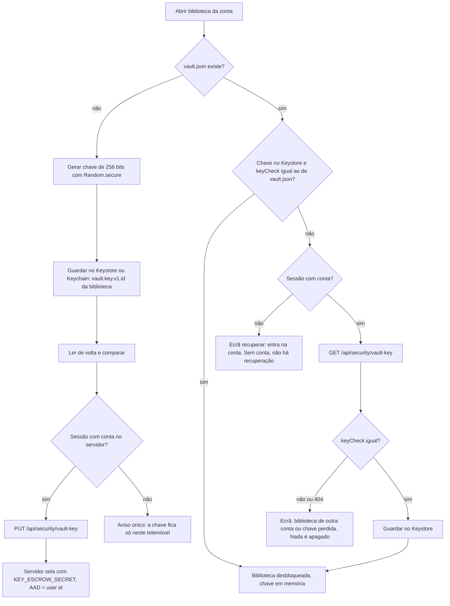
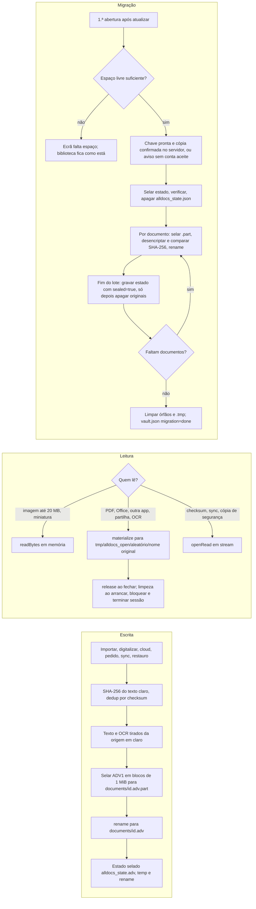

# Encriptação em repouso da biblioteca AllDocs

Plano de 23/11/2026. Objetivo: os documentos copiados para a app (CC, contratos, faturas) e o ficheiro de estado (nomes, tags, texto OCR) ficam encriptados no disco e nas cópias de segurança na cloud. As decisões do utilizador estão fechadas (ver o pedido); este documento só diz como.

Modelo de ameaça, dito com clareza: protege contra outras apps com acesso a ficheiros (hoje `/storage/emulated/0/Documents/.AllDocs` é legível por elas), contra quem copia o armazenamento por USB e contra quem lê as cópias no Google Drive, Dropbox, OneDrive ou iCloud. Não protege contra quem tem o telemóvel desbloqueado com a app aberta. Também não protege contra quem compromete o servidor e, ao mesmo tempo, tem os ficheiros do telemóvel.

## 1. Versões (confirmadas no pub.dev a 23/11/2026)

| Pacote | No projeto | Atual | Decisão |
|---|---|---|---|
| cryptography | ^2.9.0 | 2.9.0 (21/11/2025) | manter |
| cryptography_flutter | ^2.3.4 | 2.3.4 (21/11/2025) | manter; AES-GCM nativo em Android e iOS |
| flutter_secure_storage | ^9.2.2 | 11.2.0 (16/09/2026) | **manter 9.x neste trabalho** |

Porque não atualizar o flutter_secure_storage agora: na 10.0.0, `resetOnError` passa a `true` por omissão e apaga as entradas quando a leitura falha. A 11.0.0 deixa ilegíveis os dados gravados com algoritmos antigos se se saltar a 10. Para uma chave que guarda documentos, isso é perda de dados. Atualizar fica para um trabalho à parte: passar primeiro pela 10.x com `resetOnError: false` e `migrateWithBackup: true`, depois de a cópia da chave no servidor estar em produção.

Não entra nenhuma dependência nova. O espaço livre lê-se por um canal nativo pequeno (`alldocs/storage`), ao lado dos canais `alldocs/ocr` e `alldocs/icloud` que já existem.

## 2. Diagramas

### 2.1 Chave: gerar, guardar, recuperar



### 2.2 Escrita, leitura e migração



Não há `.drawio`: o plugin não está disponível nesta sessão.

## 3. Formatos

### 3.1 Ficheiro selado ADV1 (documentos, estado, manifestos das cópias)

| Posição | Bytes | Campo |
|---|---|---|
| 0 | 4 | magic `ADV1` (`41 44 56 31`) |
| 4 | 1 | versão = 1 |
| 5 | 1 | log2 do tamanho do bloco = 20 (1 MiB); aceite 16 a 24 |
| 6 | 2 | reservado = 0 |
| 8 | 8 | prefixo do nonce, aleatório por ficheiro |
| 16 | ... | blocos: texto cifrado (1 MiB, o último ≤ 1 MiB) + tag GCM de 16 |

- AES-256-GCM. Nonce do bloco *i* = prefixo (8) ‖ *i* em uint32 big-endian.
- AAD = cabeçalho (16 bytes) ‖ `1` no último bloco ou `0` nos outros. Assim, mexer no cabeçalho, trocar a ordem dos blocos, tirar blocos ou cortar o ficheiro faz a desencriptação falhar.
- Ficheiro vazio = 1 bloco de 0 bytes. Tamanho em claro = total − 16 − n.º de blocos × 16. Custo: 16 B + 16 B por MiB.
- Cada escrita (incluindo editar um documento) gera um prefixo novo. Com prefixos aleatórios de 64 bits, a colisão é desprezável: cerca de 3 × 10⁻⁸ com 1 milhão de ficheiros por chave.
- Não se liga o ID do documento à AAD. Assim, a cópia de segurança envia o `.adv` tal como está, sem desencriptar nem voltar a selar. O risco aceite é que quem consiga escrever no armazenamento possa trocar o conteúdo de dois documentos entre si (ver Riscos).
- O formato `ADS1` do sync (`sync_crypto.dart`) não muda, byte a byte. O código dos blocos passa para `ChunkedAead` e é parametrizado pelo cabeçalho e pela AAD. Os dois formatos usam esse código.

### 3.2 Nomes no disco

```
<raiz>/users/<account key>/
  vault.json               em claro, sem segredos
  alldocs_state.adv        estado: ADV1 sobre gzip(JSON)
  documents/<docId>.adv    cada documento (antes: <docId>_<nome original>)
  documents/<docId>.adv.part   só durante uma escrita
  .nomedia
```

`vault.json`: `{"v":1,"keyCheck":"<64 hex>","owner":"account"|"local","migration":"pending"|"running"|"done","updatedAt":"<ISO>"}`. O `keyCheck` é HMAC-SHA256(chave, `"alldocs-vault-check"`) e serve para distinguir "chave errada" de "ficheiro estragado". O nome original, as tags e o texto OCR só existem dentro de `alldocs_state.adv`.

Os ficheiros "Dispositivo" (DeviceFolder, scan) não mudam. Regra única: um documento é selado se e só se o `local_path` estiver dentro de `<biblioteca>/documents/`. O campo novo `sealed: true` em `DocumentFile` marca-o.

### 3.3 Keystore / Keychain

- Entrada `vault.key.v1.<id da biblioteca>` (`<account key>` ou `root`), com o valor em base64 dos 32 bytes.
- iOS: `IOSOptions(accessibility: KeychainAccessibility.first_unlock_this_device)`. Funciona em segundo plano (OCR, cópias) depois do primeiro desbloqueio e não vai para o iCloud Keychain.
- Android: as opções por omissão da 9.x, iguais às instâncias que já existem em `auth_service.dart` e `sync_service.dart`.
- Se a leitura **falhar** (exceção), isso nunca leva a gerar uma chave nova nem a apagar nada. Trata-se como "chave em falta" (ponto 2.1).
- A chave não fica presa ao PIN ou à biometria da app: o OCR e as cópias em segundo plano precisam dela. O PIN continua a proteger a interface.

## 4. Camada única: `DocumentVault`

Ficheiro `ui/lib/services/vault/document_vault.dart`. É o único sítio que sabe ler e escrever ficheiros da biblioteca.

```dart
Future<SealedFile> seal({required String docId, File? source, Uint8List? bytes}); // path, checksum (SHA-256 do claro), size
Stream<List<int>> openRead(DocumentFile doc);       // claro, em stream
Future<Uint8List> readBytes(DocumentFile doc);       // só até 20 MB; acima disso lança erro
Future<Materialized> materialize(DocumentFile doc, {bool handoff = false}); // .file, .release()
Future<SealedFile> replace(DocumentFile doc, File newContent);
Future<void> purgeTemp();                            // apaga tmp/alldocs_open/
```

- Para documentos não selados (ficheiros Dispositivo, ou documentos ainda por migrar), `materialize` devolve o próprio ficheiro e `release` não faz nada. Os callers ficam com um só caminho de código.
- `materialize` desencripta para `getTemporaryDirectory()/alldocs_open/<aleatório>/<nome original>`. É uma pasta privada da app e não entra na cópia do sistema. O nome original mantém-se porque a app que recebe o ficheiro o mostra.
- `handoff: true` (abrir noutra app, partilha do sistema): o ficheiro não é apagado ao fechar, porque a outra app ainda o lê. Só sai na limpeza.
- Limpeza (`purgeTemp`): ao arrancar (`main`), quando o `SecurityGate` bloqueia, ao terminar sessão e ao mudar de conta (listener de `CurrentUser`). O visualizador chama `release()` no `dispose`.
- A cripto corre no isolate principal: o `FlutterAesGcm` usa canais de plataforma, que não estão registados nos isolates de `Isolate.run`. Uma verificação em debug confirma que `AesGcm.with256bits()` é `FlutterAesGcm`. Se não for, chama-se `FlutterCryptography.enable()` em `main`.

### 4.1 O que muda em cada ponto que usa `localPath`

Lista completa com `grep -rn "localPath\|local_path\|storedPath" ui/lib`.

| Ficheiro | Linhas atuais | Muda para |
|---|---|---|
| `models/document_file.dart` | 36, 67, 137, 170, 216, 255 | campo `sealed` (json `sealed`, copyWith, toJson); `localPath` passa a ser o caminho do `.adv` |
| `services/local_documents_store.dart` (14) | `_copyPickedFile`/`_importOne` (385-432) | `vault.seal(...)` a partir da origem; checksum e texto tirados da origem em claro, sem desencriptar |
| | `_checksumOf` (456) | só para origens em claro; para selados usa `doc.checksum` ou o hash de `openRead` |
| | `_readState`/`_readStateFile`/`_writeStateFile` (1604-1661, 1794) | lê `alldocs_state.adv` se existir, senão `.json`; grava sempre selado. Chave em falta lança `VaultLockedException`. Estado ilegível passa a `alldocs_state.unreadable-<ts>` e **nunca é sobrescrito** (hoje é substituído por um estado vazio) |
| | `_relinkStoredFiles` (1868) | aceita também `documents/<id>.adv` |
| | `_moveStoredFiles`, `_adoptPersistentLibrary` (1754) | movem os `.adv` tal como estão; `vault.json` vai junto |
| | `_claimSharedLibrary` (1696) | biblioteca `root` selada: se a conta não tiver cópia da chave, adota a chave (renomeia a entrada no Keystore e faz PUT); se tiver outra, faz re-selagem com o motor de migração |
| | `_indexPendingDocuments`, apagar/lixo | OCR com `materialize` + `release` em `finally`; apagar continua a usar `local_path` |
| | aplicar sync (1581) | escreve com `vault.seal` |
| `services/documents_service.dart` (9) | 438 | substituir conteúdo: `vault.replace` e `ThumbnailCache.evict` |
| | 473, 485, 499, 511, 529 | entradas do PdfTools com `materialize`, `release` em `finally`; o resultado volta pela importação ou por `replace` |
| | 589-591 | partilha: `materialize(handoff: true)` |
| `common/pdf_tools_flow.dart` | 20 | sem mudança (verifica null) |
| | 309, 408 | `doc.pageCount` se existir; senão `materialize` |
| `common/device_scan_sheet.dart` | 312, 333 | sem mudança (ficheiros Dispositivo) |
| `services/backup_service.dart` | 240 | envia o `.adv` diretamente (secção 7) |
| `screens/viewer/document_viewer_screen.dart` | 60, 70, 219 | PDF/Office: `materialize` com indicador após 300 ms; imagem até 20 MB: `Image.memory(readBytes)`; `release` no dispose |
| `screens/links/links_screen.dart` | 158 | sem mudança |
| `common/secure_share_flow.dart` | 117 | `materialize`, envia, `release` em `finally` |
| `common/document_preview_card.dart` | 183, 191 | miniatura pela `ThumbnailCache`; imagem pequena com `readBytes` |
| `common/document_actions.dart` | 230 | sem mudança (verifica null); as ações vão pelo `documents_service` |
| `services/thumbnail_cache.dart` | 27-100 | recebe `DocumentFile`, renderiza a partir de `materialize`; a chave da cache usa o stat do `.adv`; continua em `getTemporaryDirectory` (privado) |
| `common/office_thumbnail_host.dart` | 25, 97 | `render` recebe o caminho materializado |
| `services/document_text_indexer.dart`, `document_text_extractor.dart` | — | assinatura igual; quem chama passa o caminho em claro (origem na importação, `materialize` no OCR em segundo plano) |
| `services/sync/sync_service.dart` | 868 e envio/receção | checksum por `doc.checksum` ou `openRead`; envio = `openRead` → `SyncCrypto.seal(stream)`; receção = `SyncCrypto.open(stream)` → `vault.seal` (o claro nunca vai para o disco) |
| `services/sync/sync_entities.dart` | 86, 273 | para selados, quem recebe ignora `stored_name` e grava em `documents/<id>.adv` |
| `services/document_requests_service.dart` | 226 | sem mudança: grava na pasta temporária privada e importa (fica selado); apaga o temporário depois |
| importação da cloud, assistente IA | — | a importação passa por `_importOne`; o assistente usa o texto do estado, sem mudança |

## 5. Migração das bibliotecas existentes

Ficheiro `ui/lib/services/vault/vault_migration.dart`. Corre no arranque, depois do `SecurityGate`, com o ecrã de progresso.

1. **Pré-condições.** Com conta: chave no Keystore e PUT confirmado (200 ou 201). Sem ligação, a migração não arranca e a biblioteca continua como hoje até haver rede. Sem conta: o aviso foi aceite.
2. **Espaço.** Necessário = max(maior documento, 100 MB) + 2 × tamanho do estado + 16 B/MiB + 100 MB de margem. Lido por `alldocs/storage.freeBytes(path)` (Android: `StatFs.availableBytes`; iOS: `volumeAvailableCapacityForImportantUsage`). Se faltar espaço, aparece o ecrã "Falta espaço" com o valor em falta. A app pode continuar sem encriptar e volta a tentar no arranque seguinte.
3. `vault.json` com `migration: running`, gravado com temp e rename.
4. **Estado.** Grava `alldocs_state.adv`, lê-o de volta, desencripta e compara com o JSON. Só depois apaga `alldocs_state.json`. Se os dois existirem, ganha o `.adv` desde que desencripte; se não desencriptar, usa o `.json`.
5. **Por documento** (só os que estão em `documents/` e têm `sealed != true`):
   1. calcula o checksum em claro, se faltar;
   2. sela para `<id>.adv.part` com flush;
   3. desencripta o `.part` em stream e compara o SHA-256 com o checksum (se forem diferentes, apaga o `.part`, marca o erro e passa ao seguinte sem tocar no original);
   4. faz rename para `<id>.adv` e atualiza o estado em memória (`local_path`, `sealed: true`).
6. **Lote.** A cada 100 MB em claro ou 20 documentos (um documento maior que 100 MB fecha o lote sozinho): grava o estado selado e **só depois** apaga os originais desse lote.
7. **Retoma.** O marcador por documento é `sealed` no estado gravado. Se a app parar antes do passo 6, o original continua referenciado e o `<id>.adv` é refeito. Se parar depois de gravar e antes de apagar, sobra um original órfão.
8. **Fim.** Limpa os órfãos: um ficheiro `<id>_*` só é apagado se o `<id>.adv` existir e estiver referenciado. Limpa também os `*.part` e `*.tmp` e grava `vault.json` com `migration: done`.
9. **Erros.** Disco cheio a meio (ENOSPC): apaga o `.part`, grava o estado, pára e mostra "Falta espaço". Os documentos com erro de verificação ficam em claro e aparecem na linha das definições ("3 documentos por proteger · Tentar de novo").
10. Enquanto o ecrã está aberto não há outras escritas na biblioteca: o sync, o OCR e as cópias ficam em pausa. As importações novas já ficam seladas desde que a chave exista.

O mesmo motor faz a re-selagem com outra chave (biblioteca `root` adotada por uma conta que já tem chave): desencripta com a antiga e sela com a nova, pelos mesmos passos.

## 6. Reinstalação, telemóvel novo, conta

| Situação | Comportamento |
|---|---|
| Reinstalar no Android com a biblioteca em `.AllDocs`, sem sessão | No arranque deteta `users/*/vault.json` e mostra "Já tens documentos neste telemóvel" com o login. Depois de entrar, abre a biblioteca da conta, não encontra a chave, faz GET, compara o `keyCheck`, guarda e abre |
| Entra com outra conta | É outra biblioteca (`users/<outra key>`). A antiga fica intacta. O ecrã "Esta biblioteca é de outra conta" só aparece se o GET devolver uma chave com `keyCheck` diferente |
| Biblioteca sem conta (`owner: local`) e sem chave | "Não é possível abrir estes documentos" + "Começar uma biblioteca nova". A pasta antiga fica como está, nada é apagado |
| Android apaga o Keystore, ou a leitura falha | Igual a "chave em falta": GET se houver conta; sem rede, aparece o ecrã "Precisas de internet para abrir a biblioteca" com "Tentar de novo" |
| Telemóvel novo (iOS ou Android) | Login, depois restauro da cópia na cloud (secção 7); a chave vem do servidor |
| Terminar sessão | A chave fica no Keystore (cada conta tem a sua entrada); `purgeTemp`. Voltar a entrar funciona sem rede |
| Eliminar conta | O servidor apaga a cópia (ON DELETE CASCADE). No telemóvel a chave fica: os documentos continuam legíveis ali, mas deixam de ser recuperáveis se reinstalares. O texto de `delete_account_screen` passa a dizê-lo |
| Sem conta → criar conta | O botão nas definições abre o registo. Depois disso, `_claimSharedLibrary`/adoção da chave e PUT |

Android Auto Backup: excluir `sharedpref` `FlutterSecureStorage.xml` em `data_extraction_rules.xml` (cloud-backup e device-transfer) e em `backup_rules.xml`. Sem isto, um telemóvel restaurado recebe o ficheiro, mas não a chave do Keystore que o abre.

## 7. Cópias de segurança na cloud (manifestVersion 3)

```
AllDocs Backups/
  Current/
    alldocs-current.adv            índice selado (caminho → checksum)
    Files/<blobId>.adv             o .adv da biblioteca, enviado tal como está
  Removed/<blobId>.adv
  Backup 2026-11-23 14-30-05/
    alldocs-state.adv              estado selado
    alldocs-backup.adv             manifesto selado, version 3
    alldocs-key.json               {"v":1,"keyCheck":"..."} em claro
```

- `blobId` = HMAC-SHA256(chave, `"backup:" + checksum`). Esconde o checksum, o que impede confirmar se um ficheiro conhecido está na cópia, e mantém a deduplicação.
- As pastas por álbum deixam de existir na v3: a organização está no estado selado. A árvore deixa de se poder navegar no Drive, consequência inevitável de encriptar os nomes.
- O `BackupStorage` não muda: `upload(path, File)` recebe o `.adv`. Os manifestos selados passam por um ficheiro temporário privado.
- **Restaurar v3:** lê `alldocs-key.json`. Se o `keyCheck` for igual ao da chave local, continua. Se não for, com sessão faz GET e compara; sem sessão mostra "Entra na conta com que fizeste esta cópia". Descarrega o blob para `<id>.adv.part`, verifica (desencripta e compara o SHA-256) e faz rename. O texto claro nunca vai para o disco.
- **Restaurar v2 e zips antigos:** continua a funcionar. Descarrega para a pasta temporária privada, importa por `vault.seal` e apaga o temporário.
- As cópias v2 em claro que já estão na cloud **não se apagam sozinhas**. Depois da primeira cópia v3 completa, aparece em Definições → Cópias de segurança o botão "Apagar cópias antigas não encriptadas", com confirmação explícita (é irreversível).
- Cópias feitas sem conta só se restauram no mesmo telemóvel. O aviso do modo sem conta diz isto.

## 8. Servidor

- **Tabela** (`Backend/scripts/schema.sql`, aplicada por `ensureSchema`):
  ```sql
  CREATE TABLE IF NOT EXISTS vault_keys (
    user_id TEXT PRIMARY KEY REFERENCES users(id) ON DELETE CASCADE,
    sealed TEXT NOT NULL,
    key_check TEXT NOT NULL,
    created_at TIMESTAMPTZ NOT NULL DEFAULT NOW()
  );
  ```
- **`Backend/src/lib/key-escrow.ts`:** `seal(userId, key)` e `open(userId, sealed)` em AES-256-GCM. IV de 12 bytes, AAD `vault-key:<userId>` (uma linha copiada para outro utilizador não abre). Formato `v1.<iv>.<ct>.<tag>` em base64url; o prefixo `v1` permite rodar o segredo mais tarde. O segredo lê-se como `key()` em `file-vault.ts`: `KEY_ESCROW_SECRET` com 32 bytes em hex ou base64; em produção, se faltar, o arranque falha; em desenvolvimento, deriva de `JWT_SECRET`.
- **Endpoints**, módulo `Backend/src/modules/vault-key/` (routes, controller, service, como em `hidden-pin`), montado em `/api/security/vault-key` com `requireAuth` e `vaultKeyLimiter` (novo em `lib/rate-limit.ts`: 15 min, 20 pedidos):
  - `GET /` → 200 `{ key, keyCheck }` ou 404.
  - `PUT /` com `{ key: base64 de exatamente 32 bytes, keyCheck: 64 hex }` → `INSERT ... ON CONFLICT DO NOTHING`. Responde 201 se criou, 200 se já existia igual e 409 se existe outra. **Nunca sobrescreve**: um cliente com erro não pode destruir a cópia boa.
  - Sem DELETE: a eliminação da conta trata disso por cascata (`deleteAccount` em `account.service.ts` já faz `DELETE FROM users`).
  - `Cache-Control: no-store`. O corpo nunca vai para os logs.
- **OpenAPI** (`src/docs/openapi.ts`): os dois caminhos, os esquemas e as respostas 401/404/409/429.
- **CapRover:** variável `KEY_ESCROW_SECRET`. O servidor tem de estar publicado **antes** da versão da app que migra.

## 9. Interface

Usa o tema claro/escuro existente (cores de `ColorScheme`, sem cores novas) e o ícone `lock` da família de ícones da app. Texto de corpo em `onSurfaceVariant`, contraste AA verificado nos dois temas. A barra de progresso tem `Semantics` com "712 de 1 240 documentos protegidos" e um anúncio a cada 10 %. Alvos de toque ≥ 48 dp. Ecrã largo (≥ 840 dp): cartão centrado com 560 dp de largura máxima, ícone à esquerda do texto. Chaves novas em `AppConstants` e `assets/translations/{pt,en,es,fr}.json`.

### 9.1 Migração (telemóvel)

```
┌──────────────────────────────────┐
│                                  │
│              ( cadeado )         │
│                                  │
│  A proteger os teus documentos   │
│                                  │
│  Estamos a encriptar a           │
│  biblioteca neste telemóvel.     │
│  Se fechares a app, continua     │
│  onde ficou.                     │
│                                  │
│  ██████████████░░░░░░░░   58 %   │
│  712 de 1 240 documentos         │
│  2,1 GB de 3,6 GB                │
│                                  │
└──────────────────────────────────┘
```

### 9.1 Migração (ecrã largo)

```
┌────────────────────────────────────────────────────────────────┐
│                                                                │
│        ┌──────────────────────────────────────────────┐        │
│        │ ( cadeado )  A proteger os teus documentos   │        │
│        │                                              │        │
│        │ Estamos a encriptar a biblioteca neste       │        │
│        │ tablet. Se fechares a app, continua onde     │        │
│        │ ficou.                                       │        │
│        │                                              │        │
│        │ ████████████████████░░░░░░░░░░░░░    58 %    │        │
│        │ 712 de 1 240 documentos · 2,1 GB de 3,6 GB   │        │
│        └──────────────────────────────────────────────┘        │
│                                                                │
└────────────────────────────────────────────────────────────────┘
```

### 9.2 Falta espaço (mesma moldura; telemóvel)

```
┌──────────────────────────────────┐
│           ( cadeado )            │
│  Falta espaço para encriptar     │
│                                  │
│  Precisas de libertar mais       │
│  640 MB. Até lá, os documentos   │
│  ficam como estavam.             │
│                                  │
│  [        Tentar de novo       ] │
│  [   Continuar sem encriptar   ] │
└──────────────────────────────────┘
```

### 9.3 Aviso do modo sem conta (folha inferior no telemóvel; diálogo de 560 dp no ecrã largo)

```
┌──────────────────────────────────┐
│  ───                             │
│  A chave fica só neste telemóvel │
│                                  │
│  Os teus documentos estão        │
│  encriptados com uma chave       │
│  guardada aqui. Sem conta        │
│  AllDocs, se desinstalares a app │
│  ou mudares de telemóvel, perdes │
│  o acesso aos documentos e às    │
│  cópias de segurança.            │
│                                  │
│  [          Criar conta        ] │
│  [            Entendi          ] │
└──────────────────────────────────┘
```

`Criar conta` só aparece quando `LocalModeConfig.isLocalOnly == false`.

### 9.4 Recuperar biblioteca após reinstalar

Telemóvel:
```
┌──────────────────────────────────┐
│           ( cadeado )            │
│  Já tens documentos neste        │
│  telemóvel                       │
│                                  │
│  Estão encriptados. Entra na     │
│  conta com que os guardaste para │
│  os voltares a abrir.            │
│                                  │
│  [   Continuar com o Google    ] │
│  [   Continuar com a Apple     ] │
│  [       Entrar com email      ] │
│                                  │
│  Usavas a app sem conta?         │
└──────────────────────────────────┘
```

Variante sem conta (depois de tocar em "Usavas a app sem conta?" ou com `owner: local`):
```
┌──────────────────────────────────┐
│  Não é possível abrir estes      │
│  documentos                      │
│                                  │
│  A chave ficou na instalação     │
│  anterior e não há cópia dela.   │
│  Os ficheiros continuam no       │
│  telemóvel, mas sem a chave não  │
│  se leem.                        │
│                                  │
│  [ Começar uma biblioteca nova ] │
│  [           Voltar            ] │
└──────────────────────────────────┘
```

Ecrã largo: o mesmo conteúdo, com o texto à esquerda e os botões numa coluna à direita, dentro do cartão de 560 dp.

### 9.5 Linha nas definições de segurança (`profile_screen.dart`, secção de segurança)

```
┌──────────────────────────────────┐
│ ( cadeado ) Encriptação          │
│             Ativa · cópia da     │
│             chave na tua conta   │
├──────────────────────────────────┤
│ ( cadeado ) Encriptação          │
│             Ativa · chave só     │
│             neste telemóvel      │
│             [ Criar conta ]      │
├──────────────────────────────────┤
│ ( cadeado ) Encriptação          │
│             Cópia da chave por   │
│             enviar · sem ligação │
└──────────────────────────────────┘
```

Tocar na linha abre o texto do aviso 9.3, adaptado ao caso. No ecrã largo é a mesma linha, na coluna de definições.

## 10. Desempenho

- PDF de 200 MB: `materialize` = 200 blocos AES-GCM nativos + 200 MB escritos. Meta: menos de 5 s num Android de gama média e menos de 3 s num iPhone recente, sem frames perdidos acima de 16 ms enquanto o indicador roda. Na mesma sessão, reabrir o mesmo documento reaproveita o ficheiro materializado até ao `release`.
- Miniaturas: imagens até 20 MB em memória; PDF e Office passam por `materialize` dentro do limite de concorrência que a `ThumbnailCache` já tem. O resultado fica em cache, por isso o custo só se paga uma vez.
- OCR em segundo plano: um documento de cada vez, `materialize` → OCR → `release`.
- O SHA-256 da verificação corre em blocos de 1 MiB no isolate principal, intercalado com awaits. Só acontece na migração e no restauro.
- Se a meta falhar: correr o selar/abrir num isolate com `BackgroundIsolateBinaryMessenger.ensureInitialized` e `FlutterCryptography.enable()`. Só se o teste F1 o mostrar.

## 11. Riscos e mitigação

| Risco | Mitigação |
|---|---|
| Perder a chave = perder tudo | A conta só migra depois de a cópia no servidor estar confirmada. Falhas de leitura do Keystore nunca geram chave nova. Auto Backup exclui `FlutterSecureStorage.xml`. O `keyCheck` em `vault.json` e nas cópias. Nada se apaga automaticamente sem chave. Aviso do modo sem conta |
| Bug no formato ou na migração estraga documentos | O original só se apaga depois de desencriptar e comparar o SHA-256 e de o estado estar gravado. Testes com falhas injetadas em cada passo. Lançamento por fases: teste interno, depois 10 % no Play e na TestFlight |
| Estado ilegível substituído por um vazio (acontece hoje) | Renomear para `.unreadable-<ts>` e lançar `VaultLockedException`; nunca sobrescrever |
| Perder o `KEY_ESCROW_SECRET` | As bibliotecas nos telemóveis continuam a abrir, mas ninguém recupera depois de reinstalar. Guardar uma cópia fora do CapRover (gestor de palavras-passe). Nunca o mudar sem um script de re-selagem `v1` → `v2` |
| Fuga do segredo + base de dados | Dá acesso às chaves; é preciso ter também os ficheiros. Rodar o segredo e re-selar |
| Sessão roubada lê a cópia da chave | `requireAuth` + rate limit + lista de dispositivos com sessão, que já existe; o `security-auditor` avalia se é preciso exigir login recente |
| Restos em claro | Cache temporária privada e limpa; miniaturas na cache privada; cópias v2 antigas na cloud (botão para as apagar). Em memória flash, apagar o original não garante que o conteúdo desaparece fisicamente: diz-se isto no texto de ajuda e não se promete o contrário |
| Troca de conteúdo entre dois `.adv` por quem escreve no disco | Aceite: o `checksum` em claro está no estado selado e o `security-auditor` decide se a verificação ao abrir compensa |
| Outro dispositivo com a versão antiga no sync | O conteúdo do sync vai desencriptado da camada do vault e só selado com a chave do sync, por isso é compatível. Há um teste com um emissor antigo |
| Atualizar flutter_secure_storage para 10/11 | Fora deste trabalho (secção 1) |
| App morta pelo sistema durante a migração | Retoma (passo 7) |

## 12. Tarefas

Ordem obrigatória: A antes de publicar a app; B → C → D → E → F. Verificação de cada tarefa: o comando e a saída esperada.

### A. Servidor

| # | Agente | Ficheiros | Verificação |
|---|---|---|---|
| A1 | web-dev | `Backend/scripts/schema.sql` (tabela `vault_keys`) | `npm run build` sem erros; arrancar contra o Postgres local; `psql -c '\d vault_keys'` mostra a FK com cascata |
| A2 | web-dev | `Backend/src/lib/key-escrow.ts`, `Backend/test/key-escrow.test.ts`, script `"test": "node --import tsx --test test/*.test.ts"` em `package.json` | `npm test`: ida e volta OK; outro userId falha; byte adulterado falha; segredo de 31 bytes lança; em produção sem segredo lança |
| A3 | web-dev | `Backend/src/modules/vault-key/{vault-key.routes,vault-key.controller,vault-key.service}.ts`, `Backend/src/main.ts`, `Backend/src/lib/rate-limit.ts` | `Backend/test/vault-key.test.ts` (supertest dispensado; `fetch` ao servidor local): GET sem sessão 401; PUT 201, igual 200, outra 409; GET devolve igual; 21.º pedido 429; depois de `deleteAccount` a linha desaparece |
| A4 | web-dev | `Backend/src/docs/openapi.ts` | `/docs` mostra os dois caminhos; `npm run build` |
| A5 | automacao | CapRover (variável de ambiente) | No Mac: `openssl rand -base64 32`; guardar no gestor de palavras-passe; definir `KEY_ESCROW_SECRET` na app do CapRover; deploy; `curl -i https://all-docs-backend.triplanai.eupasoft.com/api/security/vault-key` → 401 |

### B. Formato e chave

| # | Agente | Ficheiros | Verificação |
|---|---|---|---|
| B1 | flutter-dev | `ui/lib/services/vault/chunked_aead.dart`; `sync_crypto.dart` passa a usá-lo (stream de entrada e de saída) | `ui/test/sync_crypto_test.dart` novo: ficheiro selado pelo código antigo (fixture binária gerada antes da mudança) abre com o novo; `flutter test` verde |
| B2 | flutter-dev + flutter-tester | `ui/lib/services/vault/vault_format.dart`, `ui/test/vault_format_test.dart` | ida e volta com 0, 1, 1 MiB−1, 1 MiB, 1 MiB+1 e 5 MiB; falham: byte alterado em cada zona, cabeçalho alterado, blocos trocados, último bloco cortado, bloco a mais, chave errada, magic errado, versão 2 |
| B3 | flutter-dev + flutter-tester | `ui/lib/services/vault/vault_keyring.dart` (Keystore + `ApiHelpers` GET/PUT + `keyCheck` + envio pendente) | `ui/test/vault_keyring_test.dart` com armazenamento e API falsos: leitura que lança não gera chave; 409 não substitui a local; sem rede fica pendente e volta a tentar; `keyCheck` diferente = em falta |
| B4 | flutter-dev | `ui/android/app/src/main/res/xml/{data_extraction_rules,backup_rules}.xml`; `IOSOptions` em `vault_keyring.dart` | `flutter build apk --debug` OK; `grep FlutterSecureStorage.xml` nos dois XML |
| B5 | flutter-dev | canal `alldocs/storage`: `MainActivity.kt`, `AppDelegate.swift`, `ui/lib/services/vault/free_space.dart` | teste unitário com canal simulado; no aparelho, o valor bate com as Definições do sistema (±1 %) |

### C. Camada única, estado e migração

| # | Agente | Ficheiros | Verificação |
|---|---|---|---|
| C1 | flutter-dev | `ui/lib/models/document_file.dart` (`sealed`) | teste de ida e volta em JSON |
| C2 | flutter-dev + flutter-tester | `ui/lib/services/vault/document_vault.dart` | `ui/test/document_vault_test.dart`: seal/openRead/readBytes/materialize/replace; ficheiro Dispositivo passa sem mudança; `readBytes` acima de 20 MB lança; `purgeTemp` esvazia a pasta; o checksum é o do claro |
| C3 | flutter-dev + flutter-tester | `ui/lib/services/local_documents_store.dart` (estado selado, importação selada, relink, `VaultLockedException`, `.unreadable`, adoção/re-selagem em `_claimSharedLibrary`) | os testes `local_documents_store_*_test.dart` atuais passam com uma chave de teste; novos: sem chave não sobrescreve o estado; dedup por checksum continua; `grep -c "_"` nos nomes de `documents/` = 0 |
| C4 | flutter-dev + flutter-tester | `ui/lib/services/vault/vault_migration.dart` (com gancho de falhas para testes) | `ui/test/vault_migration_test.dart`: interromper depois de cada passo (part, rename, antes e depois de gravar o estado, antes de apagar) e retomar → todos os checksums iguais, zero ficheiros em claro, Dispositivo intacto; ENOSPC simulado → original intacto; falta de espaço → não arranca; re-selagem com outra chave |
| C5 | flutter-dev | visualizador, `document_preview_card.dart`, `thumbnail_cache.dart`, `office_thumbnail_host.dart`, OCR em `_indexPendingDocuments` | `flutter analyze` sem avisos; teste de widget do visualizador com PDF selado; miniatura gerada a partir de selado |
| C6 | flutter-dev | `documents_service.dart`, `pdf_tools_flow.dart`, `secure_share_flow.dart` | testes de juntar, extrair e comprimir PDF selado → resultado selado e legível; `purgeTemp` deixa a pasta vazia depois de partilhar |
| C7 | flutter-dev + flutter-tester | `sync_service.dart`, `sync_entities.dart` | `sync_entities_test.dart` + novo: quem recebe grava `<id>.adv` e ignora `stored_name`; emissor antigo (nome legível) → quem recebe sela |
| C8 | flutter-dev | limpeza: `main.dart`, `security_gate.dart`, terminar sessão em `auth_service.dart`, listener de `CurrentUser` | teste: depois de bloquear, `alldocs_open/` está vazia |

### D. Cópias de segurança

| # | Agente | Ficheiros | Verificação |
|---|---|---|---|
| D1 | flutter-dev | `backup_service.dart` (escrita v3, `blobId`, manifestos selados, `alldocs-key.json`) | `backup_service_test.dart`: depois de copiar, a árvore só tem `.adv` e `alldocs-key.json`; uma segunda cópia sem mudanças não envia nada |
| D2 | flutter-dev + flutter-tester | `backup_service.dart`, `common/backup_flow.dart`, `common/backup_history.dart` (restauro v3/v2/zip) | fixtures v2 e zip restauram e ficam selados; v3 ida e volta; `keyCheck` diferente sem sessão → erro com a mensagem certa; blob adulterado → recusado sem estragar a biblioteca |
| D3 | flutter-dev | "Apagar cópias antigas não encriptadas" em `screens/cloud/cloud_screen.dart` | teste com `DeviceBackupStorage`: só apaga v2 e zips depois de confirmar; v3 intacta |

### E. Fluxo e interface

| # | Agente | Ficheiros | Verificação |
|---|---|---|---|
| E1 | flutter-dev | `ui/lib/screens/vault/vault_gate.dart`, ligado em `auth_gate.dart` depois do `SecurityGate` | testes de widget dos quatro ramos: abrir, migrar, recuperar com conta, irrecuperável sem conta |
| E2 | flutter-dev | `screens/vault/{vault_migration_screen,vault_recover_screen}.dart`, folha do aviso, linha em `profile_screen.dart`, texto em `delete_account_screen.dart`, `app_constants.dart`, `translations/{pt,en,es,fr}.json` | goldens em claro e escuro com 390×844 e 1280×800; `meetsGuideline(textContrastGuideline)` e `androidTapTargetGuideline` passam |
| E3 | flutter-dev | textos novos | `/humanizar` sobre os textos pt; sem travessões em série nem frases feitas |

### F. Prova e revisão

| # | Agente | Ficheiros | Verificação |
|---|---|---|---|
| F1 | flutter-tester | `ui/integration_test/vault_benchmark_test.dart` | Android real (corre no aparelho por `flutter test integration_test/... -d <id>` no Mac) e iPhone real: `materialize` de 200 MB abaixo das metas da secção 10; migração de 300 documentos/2 GB; `adb shell am force-stop com.alldocs.app` a meio e retoma sem perdas |
| F2 | flutter-tester | lista de verificação manual no PR | Android: desinstalar → instalar → entrar → biblioteca abre; `adb shell pm clear` → login recupera; `find /storage/emulated/0/Documents/.AllDocs -type f ! -name '*.adv' ! -name vault.json ! -name .nomedia` → vazio. iOS: telemóvel novo → login → restaurar cópia v3. "Abrir noutra app" e "Partilhar" funcionam com ficheiros materializados |
| F3 | security-auditor | todo o diff | sem chave em logs; nonce único; AAD certa; endpoints com `requireAuth`, rate limit e `no-store`; limpeza da cache; parecer sobre "login recente" e troca de `.adv` |

## 13. Custo

Nada pago de novo. Uma linha por conta na base de dados atual, uma variável de ambiente no CapRover e nenhuma API paga. As cópias na cloud ficam com o mesmo tamanho (+16 B por MiB). Na primeira cópia v3, todos os ficheiros voltam a ser enviados uma vez, e até o utilizador apagar as cópias v2 ocupam o dobro do espaço na conta dele (Drive/Dropbox/OneDrive). Esse espaço pode custar-lhe dinheiro se estiver perto do limite.

## 14. Suposições

1. "Modo sem conta" = biblioteca sem sessão no servidor: builds com `LocalModeConfig.isLocalOnly == true` ou a biblioteca `root`. O botão "Criar conta" só aparece quando há servidor.
2. Com conta, a migração espera pela confirmação da cópia no servidor. Sem rede, a biblioteca continua em claro até haver ligação. Escolhido por ser o mais seguro para os dados.
3. A chave não depende do PIN nem da biometria, para o OCR e as cópias funcionarem em segundo plano.
4. Ao eliminar a conta, a chave local não se apaga: os documentos continuam legíveis naquele telemóvel.
5. As cópias v2 em claro na cloud só se apagam por ação explícita do utilizador.
6. O ecrã de migração bloqueia a app até acabar (pode ser retomado); não há "continuar mais tarde" a meio, exceto por falta de espaço.
7. A AAD não inclui o ID do documento, para a cópia de segurança enviar o `.adv` sem re-selar (risco aceite na secção 11).
8. Limite de 20 MB para leitura em memória; acima disso, `materialize`.
9. Rate limit de 20 pedidos por 15 min no endpoint da chave.
10. flutter_secure_storage fica na 9.x neste trabalho.
11. Os testes do backend usam o test runner do Node com `tsx` (já é devDependency); não entra Jest nem supertest.
12. Não há `.drawio` (plugin indisponível nesta sessão).
